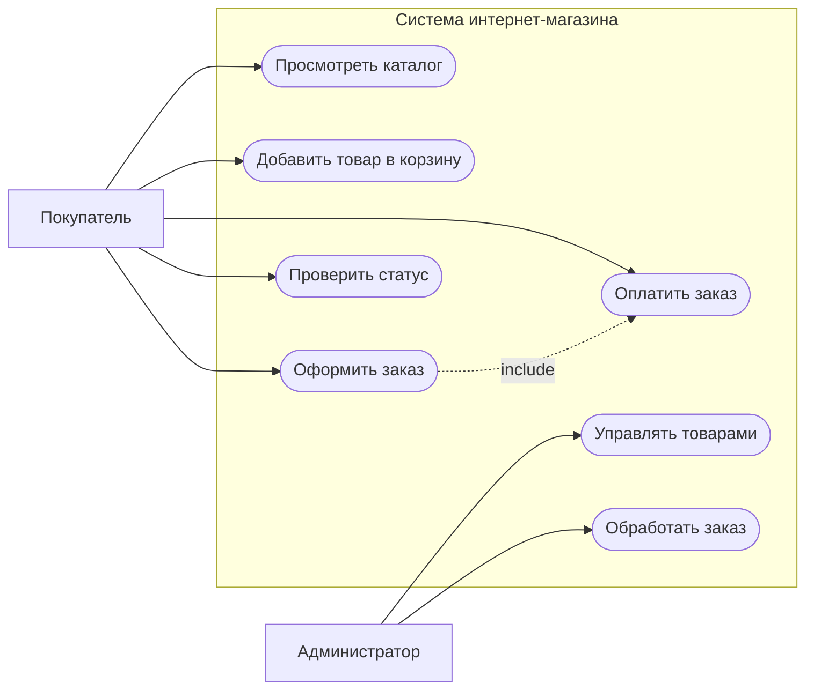
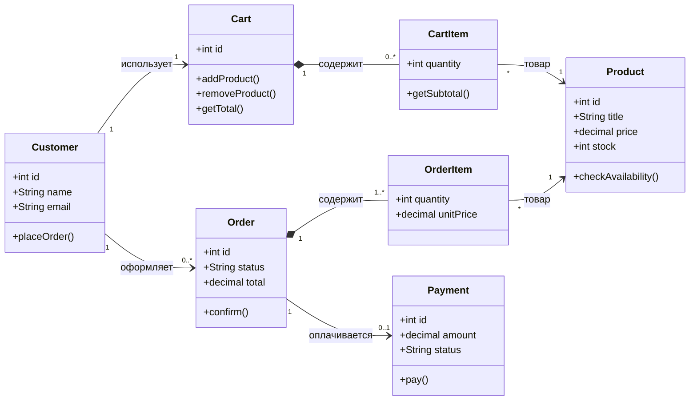
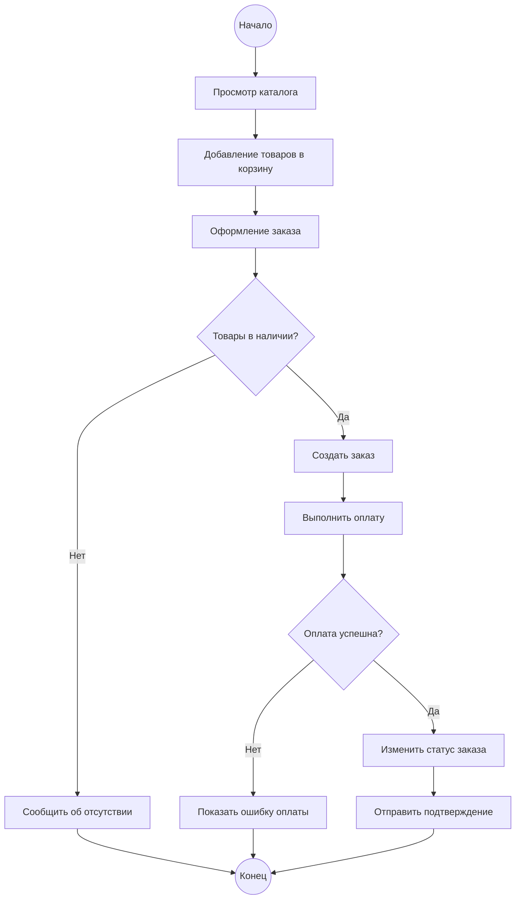
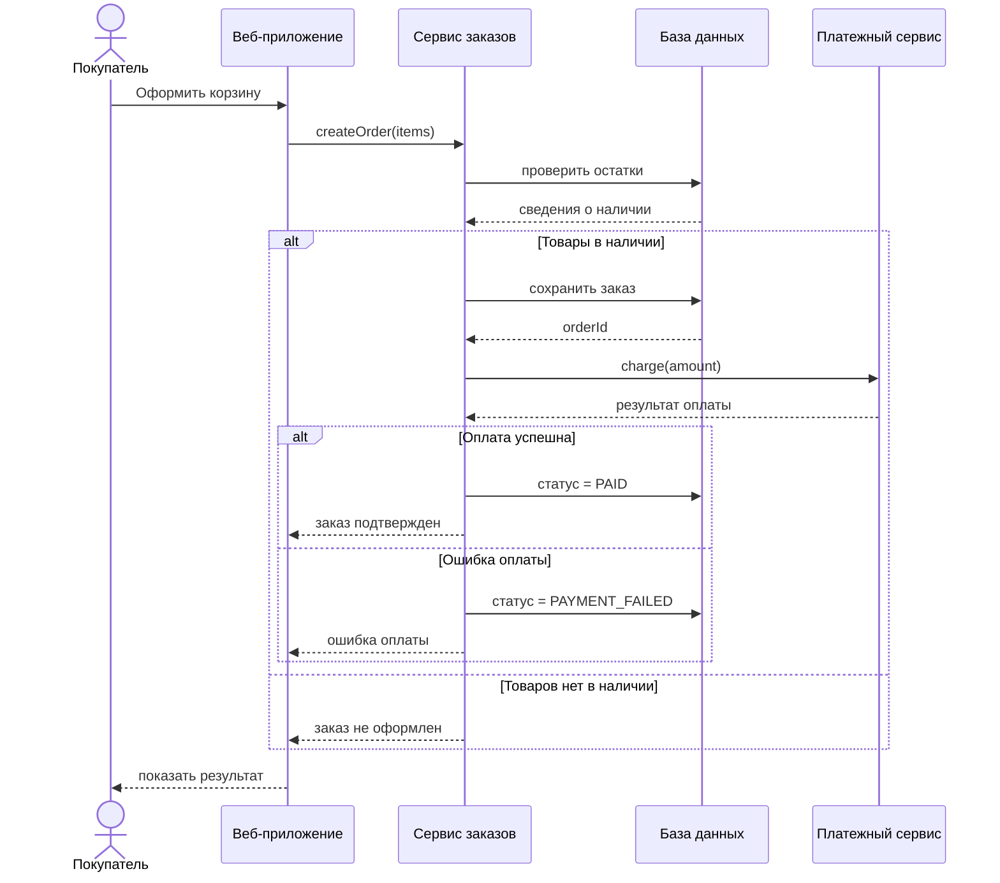

# КТ №2. UML-диаграммы интернет-магазина

**Дисциплина:** Архитектура корпоративных приложений  
**Выполнила:** Алакберова Симран Ахлиман  
**Группа:** 4П1.23

**Предметная область:** система управления заказами интернет-магазина.

В репозитории находятся четыре диаграммы. Они отображаются прямо на GitHub. Исходники PlantUML размещены в папке `uml`.

**[Открыть подробный отчет](./ОТЧЕТ_КТ2.md)**

## Диаграмма прецедентов

[Исходник PlantUML](./uml/usecase.puml)

## Диаграмма классов

[Исходник PlantUML](./uml/classes.puml)

## Диаграмма активностей

[Исходник PlantUML](./uml/activity.puml)

## Диаграмма последовательности

[Исходник PlantUML](./uml/sequence.puml)
